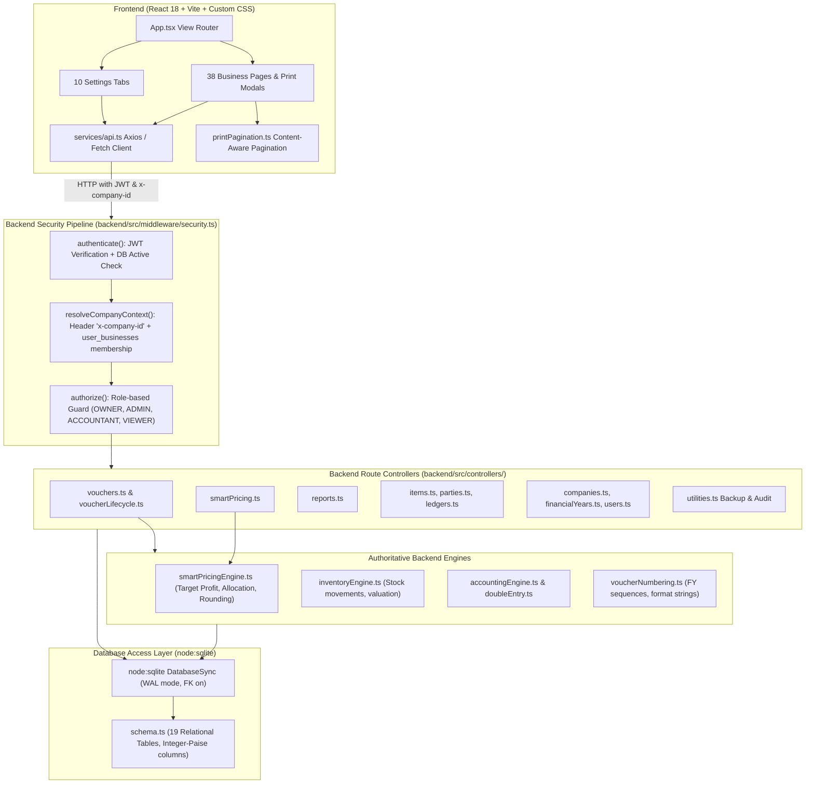

# LedgerFlow: Master Project State & Handover Report

**Task ID:** PROJECT-STATE-001  
**Audit Date:** 2026-10-15  
**Audit Mode:** Read-Only Inspection → Evidence Collection → State Documentation  
**Repository Root:** `g:/HTML/LedgerFlow`  
**Git HEAD:** `ab777060ef4e09128743fab0bdf5ef97380fcb86` (Branch: `main`)  
**Commit Message:** `smart Quotation pricing`  
**Working Tree Status:** Dirty (modified: `frontend/dist/index.html`, `frontend/src/components/invoice/StandardInvoice.tsx`, `frontend/src/pages/InvoicePrintModal.tsx`, `frontend/src/pages/QuotationPrintModal.tsx`, `STATUS.md`; untracked: `UI-029-IMPLEMENTATION-REPORT.md`, `frontend/LedgerFlow UI Mockups/Quotation Template.png`, `frontend/dist/assets/index-DfoXM51E.js`, `frontend/src/utils/printPagination.ts`, `test-ui026-print-system.mjs`)  

---

## 1. Executive Summary

LedgerFlow is a modern, high-precision desktop and web accounting, GST compliance, inventory, and quotation management software system tailored for Indian small and medium enterprises (MSMEs). 

Key architectural achievements verified during this audit:
1. **Mathematical Invariance:** Pure integer-paise representation (`paise = ₹ * 100`) across all ledger entries, stock valuation, tax lines, vouchers, and smart pricing engines, preventing floating-point drift.
2. **Double-Entry Enforcement:** Database transactions post balanced debits and credits (`sum(debit_paise) == sum(credit_paise)`) with foreign-key referential integrity in SQLite (WAL mode).
3. **Multi-Tenant Security:** A 3-layer middleware security architecture (`authenticate` → `resolveCompanyContext` → `authorize`) enforcing strict company isolation across all routes, verified by 20 dedicated isolation and sole-owner safety tests.
4. **Autonomous Domain Engines:** Authoritative backend calculation engines for double-entry posting, inventory movements (FIFO/moving average), voucher lifecycle transitions, financial year boundaries, and smart pricing allocations.
5. **Print & Pagination:** Dynamic, content-aware multi-page A4 print pagination engine dividing invoice and quotation rows cleanly across pages with page-1 hero headers, continuation headers, and bottom-anchored totals/signatures.

---

## 2. Technology Stack & Runtime Environment

### 2.1 Runtime & Package Management
- **Node.js Runtime:** `v26.7.0` (Native `node:sqlite` module support built-in)
- **Package Manager:** `npm v11.19.0`
- **Operating System:** Windows 10/11 x64 (PowerShell shell environment)

### 2.2 Backend Stack
- **Framework:** Express.js `4.21.1` with TypeScript `5.6.3`
- **Execution Engine:** `tsx v4.19.1` (development) / `tsc` (production build to `dist/`)
- **Database Engine:** `node:sqlite` (`DatabaseSync`), SQLite 3 with Write-Ahead Logging (`PRAGMA journal_mode = WAL`) and foreign key enforcement (`PRAGMA foreign_keys = ON`)
- **Database Location:** `backend/data/ledgerflow.db` (Schema initializations in `backend/src/db/schema.ts` and `backend/src/db/migrations.ts`)
- **Security & Crypto:** `jsonwebtoken 9.0.2`, `bcryptjs 2.4.3`, `cors 2.8.5`

### 2.3 Frontend Stack
- **Framework:** React `18.3.1` with TypeScript `5.6.3`
- **Bundler & Dev Server:** Vite `5.4.9`
- **Styling System:** Custom Vanilla CSS Design System (`frontend/src/index.css`, `frontend/src/components.css`) using CSS custom properties for dark/light themes, typography, and print media rules.
- **Icons:** `lucide-react 0.453.0`
- **Routing:** Component-driven single-page routing managed inside `frontend/src/App.tsx` (38 view routes and 10 settings tabs).

---

## 3. Architecture & System Boundaries

### 3.1 Architectural Diagram



### 3.2 Authoritative Domain Boundaries & Invariants
1. **Financial Precision:** Currency is stored as integer paise in the database (`debit_paise`, `credit_paise`, `taxable_amount_paise`, `cgst_paise`, `sgst_paise`, `igst_paise`, `cess_paise`, `round_off_paise`, `total_amount_paise`, `purchase_rate_paise`, `selling_rate_paise`). Conversion from rupees occurs immediately upon API input (`Math.round(val * 100)`).
2. **Double-Entry Balance:** In `vouchers.ts`, every approved/posted voucher requires:
   $$\sum \text{debit\_paise} = \sum \text{credit\_paise}$$
   Voucher lines generate synchronized rows in `ledger_entries`. Transactions abort and rollback if invariant does not hold.
3. **Multi-Tenancy Guard:** Every query filters by `company_id = ?` matching the validated context in `req.companyId`. Multi-company isolation tests confirm that cross-tenant access attempts fail with HTTP 403/404.
4. **Voucher Immutability:** Cancelled or deleted vouchers cannot be re-posted without explicit reverse journal entries or un-cancelling workflows. Audit logs capture all state mutations.

---

## 4. Database Schema Overview

The database resides at `backend/data/ledgerflow.db`. Inspection of `backend/src/db/schema.ts` confirms 19 authoritative tables:

| Table Name | Primary Purpose | Record Count (Current DB) | Key Columns & Constraints |
| :--- | :--- | :--- | :--- |
| `users` | System credentials & accounts | 290 | `id`, `email`, `password_hash`, `full_name`, `role`, `status` |
| `companies` | Multi-tenant company profiles | 290 | `id`, `name`, `trade_name`, `gstin`, `pan`, `email`, `phone`, `currency`, `invoice_settings` (JSON) |
| `user_businesses` | User-to-company membership mapping | 291 | `id`, `user_id`, `company_id`, `role` (OWNER, ADMIN, ACCOUNTANT, VIEWER), `is_default` |
| `financial_years` | Period bounds & period locks | 311 | `id`, `company_id`, `name`, `start_date`, `end_date`, `status` (OPEN, LOCKED, CLOSED) |
| `ledger_groups` | Chart of accounts hierarchy | 5,510 | `id`, `company_id`, `name`, `nature` (ASSET, LIABILITY, INCOME, EXPENSE), `parent_group_id` |
| `ledgers` | Individual ledger accounts | 6,073 | `id`, `company_id`, `name`, `code`, `group_id`, `opening_balance_paise`, `current_balance_paise` |
| `ledger_entries` | Authoritative double-entry postings | 549 | `id`, `voucher_id`, `ledger_id`, `debit_paise`, `credit_paise`, `entry_date` |
| `vouchers` | Header records for all financial events | 295 | `id`, `company_id`, `financial_year_id`, `voucher_type`, `voucher_number`, `date`, `total_amount_paise`, `status` |
| `voucher_lines` | Line items (items/accounts) on vouchers | 230 | `id`, `voucher_id`, `item_id`, `ledger_id`, `quantity`, `rate_paise`, `taxable_amount_paise`, `gst_rate` |
| `tax_entries` | Tax component breakdown per voucher | 93 | `id`, `voucher_id`, `tax_type` (CGST, SGST, IGST, CESS), `rate`, `amount_paise` |
| `stock_items` | Goods and inventory master records | 199 | `id`, `company_id`, `name`, `sku`, `hsn_sac_code`, `unit_id`, `purchase_rate_paise`, `selling_rate_paise`, `closing_stock` |
| `stock_entries` | Physical inventory movements | 153 | `id`, `voucher_id`, `item_id`, `godown_id`, `movement_type` (IN, OUT), `quantity`, `rate_paise`, `valuation_paise` |
| `stock_item_serials` | Serial & IMEI tracking | 9 | `id`, `item_id`, `serial_number`, `status` |
| `units` | Measurement units (PCS, KGS, BOX, etc.) | 1,450 | `id`, `company_id`, `name`, `symbol`, `decimal_places`, `is_system` |
| `godowns` | Physical warehouses & store locations | 290 | `id`, `company_id`, `name`, `address` |
| `parties` | Customers, vendors, and contractors | 209 | `id`, `company_id`, `name`, `party_type` (CUSTOMER, VENDOR, BOTH), `gstin`, `pan`, `phone`, `email` |
| `party_addresses` | Billing & shipping addresses per party | 217 | `id`, `party_id`, `address_type`, `street_address`, `city`, `state`, `pincode`, `state_code` |
| `bill_allocations` | Bill-by-bill outstanding allocations | 147 | `id`, `voucher_id`, `party_id`, `bill_number`, `allocated_amount_paise`, `allocation_type` |
| `audit_logs` | Immutable audit trail of system events | 432 | `id`, `company_id`, `user_id`, `action`, `entity_type`, `entity_id`, `details` (JSON), `timestamp` |

---

## 5. Subsystem Deep-Dive

### 5.1 Accounting & GST Engine
- **Tax Model:** Destination-based Indian GST. Place of supply determines whether CGST + SGST (intra-state: company state code == party state code) or IGST (inter-state: company state code != party state code) is applied.
- **Voucher Lifecycle:**
  `DRAFT` $\rightarrow$ `POSTED` $\leftrightarrow$ `CANCELLED` (or soft `DELETED`).
  When posted, lines generate ledger and inventory entries atomically inside a database transaction.
- **Reporting Reconciliations:**
  - `Trial Balance`: $\sum \text{Debits} = \sum \text{Credits}$.
  - `Profit & Loss`: $\text{Revenue} - \text{Cost of Goods Sold} - \text{Operating Expenses} = \text{Net Profit}$.
  - `Balance Sheet`: $\text{Assets} = \text{Liabilities} + \text{Equity} + \text{Retained Earnings (Net Profit)}$.
  - Reconciliations are verified by `backend/src/tests/accounting-invariants.test.ts` and `test-reports-integration-reconciliation.js`.

### 5.2 Smart Pricing Engine
Located in `backend/src/services/smartPricingEngine.ts` and exposed via `POST /api/smart-pricing/calculate`:
- **Cost Binding:** Acquisition costs are drawn strictly from `stock_items.purchase_rate_paise / 100` or explicit manual quotation cost inputs. If an item cost is 0 or missing, the engine flags `missingCostItemCount` and disallows false profit calculations.
- **Pricing Methods:**
  1. `TARGET_PROFIT`: Computes overall target revenue as $\sum \text{Costs} + \text{Target Profit}$, allocating margin across line items.
  2. `TARGET_TOTAL`: Computes line prices to match a desired total invoice value.
  3. `MARKUP_PERCENT`: Adds a fixed percentage markup on top of dealer cost per item.
  4. `GROSS_MARGIN_PERCENT`: Computes selling price based on desired gross margin: $\text{Price} = \frac{\text{Cost}}{1 - \text{Margin}}$.
  5. `MANUAL`: Supports line-by-line manual unit prices while computing real-time gross margin and net profit.
- **Allocation Strategies:**
  - `PROPORTIONAL_COST`: Higher-cost items absorb proportionally higher margin shares.
  - `PROPORTIONAL_QTY`: Margin allocated proportionally based on unit counts.
  - `EQUAL`: Margin allocated equally across line items.
- **Strict Rounding Modes:**
  - `EXACT_2_DECIMALS`, `NEAREST_1`, `ROUND_5`, `ROUND_10`, `ROUND_50`, `ROUND_100`.
  - In `ROUND_50`, all calculated unit prices are rounded to exact multiples of ₹50. The difference between calculated profit and target profit is reflected in `reconciliationDelta` without falsely claiming exact `targetAchieved = true`.
- **Privacy Assurance:** Dealer cost fields and margin metrics are scrubbed from customer-facing print outputs (`StandardInvoice.tsx`, `QuotationPrintModal.tsx`).

### 5.3 Invoice & Quotation Print Subsystem
Located in:
- `frontend/src/components/invoice/StandardInvoice.tsx`
- `frontend/src/pages/InvoicePrintModal.tsx`
- `frontend/src/pages/QuotationPrintModal.tsx`
- `frontend/src/utils/printPagination.ts`

- **Content-Aware Pagination Algorithm:**
  - Uses fixed A4 physical budget (1020px printable height).
  - Page 1 contains full company hero card, document details badge, billing/shipping address cards, and dynamic item rows.
  - Page 2..N contain a compact continuation banner, document reference, page number, and repeated table headers.
  - Final page reserves space for totals summary table, amount in words, bank account details, terms & conditions, and authorized signature.
- **Template Types:**
  - `Standard A4`: Production-ready, validated for 1-page, 2-page, and 3-page layouts.
  - `Simple A4`: Minimalist monochrome format for low-ink printing.
  - `Thermal (3-inch/80mm)`: Continuous roll format for retail POS counters.
- **Verified Print Fixes:**
  - Company logo only renders if configured in settings (`company.logo_url` present and non-empty).
  - Full-screen modal overlay with preview controls (`window.print()`).
  - Dark mode styles are completely isolated during print (`@media print` rules force `#ffffff` background and `#0f172a` deep navy ink).

### 5.4 Settings Subsystem
Located in `frontend/src/pages/settings/`:
- **10 Modular Settings Tabs:**
  1. `CompanyProfileTab.tsx`: Persisted to `companies` table via `PUT /api/companies/current`.
  2. `TaxGstTab.tsx`: GSTIN, state code, default tax rates, composition scheme flags.
  3. `InvoicePrintingTab.tsx`: Invoice prefixes, paper format, default terms, bank details, logo upload.
  4. `AccountingPreferencesTab.tsx`: Round-off rules, negative balance warnings, discount ledgers.
  5. `FinancialYearTab.tsx`: Creation of new FYs, period locking (`LOCKED`), year closing (`CLOSED`).
  6. `UsersPermissionsTab.tsx`: Role management (`OWNER`, `ADMIN`, `ACCOUNTANT`, `VIEWER`), invitations, sole-owner lockout safeguards.
  7. `BackupSystemTab.tsx`: SQLite atomic backup generation (`VACUUM INTO`), system audit logs viewer.
  8. `VoucherConfigTab.tsx`: Prefix, suffix, auto-numbering padding rules.
  9. `LedgersGroupsTab.tsx`: Account hierarchy management.
  10. `InventoryTab.tsx`: Stock valuation methods (FIFO vs. Average), low stock threshold defaults.

---

## 6. Security & Multi-Tenant Isolation

### 6.1 Authentication Architecture
- Stateless JWT tokens passed via `Authorization: Bearer <token>` or `x-auth-token` headers.
- Secret: Authoritative `JWT_SECRET` configured in `backend/src/middleware/security.ts`. In development, defaults to a stable process-local random secret; in production (`NODE_ENV === 'production'`), refuses to boot if `JWT_SECRET` is unset.
- Password storage: Strong bcrypt hashing (`bcryptjs.hash(password, 10)`).

### 6.2 Multi-Tenant Context Resolution
- The frontend sends the selected company ID via the `x-company-id` HTTP request header.
- The `resolveCompanyContext` middleware queries `user_businesses` to ensure the authenticated user belongs to the requested company. If not, it rejects the request with HTTP 403 Forbidden.
- All subsequent SQL operations bind `company_id = req.companyId`.

### 6.3 Sole-Owner Protection
- If a user is the only `OWNER` of a company, the backend prevents:
  - Demoting the user's role to Admin/Accountant/Viewer.
  - Deleting or removing the user from the business.
  - Tests verify that HTTP 400 with a descriptive error message is returned.

---

## 7. Build & Startup Commands

### Development Mode
```bash
# Terminal 1: Backend API (runs on http://localhost:5000)
cd g:\HTML\LedgerFlow\backend
npm run dev

# Terminal 2: Frontend App (runs on http://localhost:5173)
cd g:\HTML\LedgerFlow\frontend
npm run dev
```

### Production Build & Validation
```bash
# Build backend
cd g:\HTML\LedgerFlow\backend
npm run build

# Build frontend
cd g:\HTML\LedgerFlow\frontend
npm run build
```

### Running Test Suites
```bash
# Run all backend automated tests (354+ tests)
cd g:\HTML\LedgerFlow\backend
npm test

# Run specific integration scripts from root
cd g:\HTML\LedgerFlow
node test-ui026-print-system.mjs
node test-ui024-smart-pricing-e2e.mjs
node test-ui023-e2e.js
node test-ui021-voucher-lifecycle.js
node test-ui020-invoice-settings.js
node test-ui019-settings.js
node test-reports-integration-reconciliation.js
```
