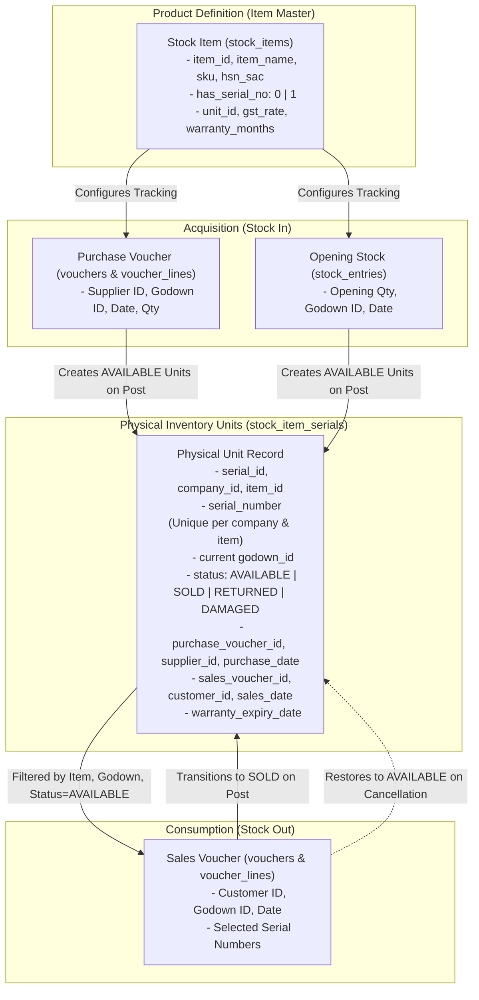

# UI-045: LedgerFlow Serial Number Tracking & Inventory Lifecycle
## Implementation Plan & Architectural Roadmap

**Date:** 2026-11-08  
**Project:** LedgerFlow Accounting & Inventory Management System  
**Document:** `UI-045-IMPLEMENTATION-PLAN.md`  
**Status:** Approved for Implementation  

---

### 1. Architectural Strategy & Target Separation

The fundamental architectural principle of UI-045 is the clean separation of **Product Definition** from **Physical Inventory Units**:



---

### 2. Implementation Phases & Sequence

```mermaid
flowchart LR
    Phase1["Phase 1: Audit
    (Completed)"] --> Phase2["Phase 2: Database Schema & Migration"]
    Phase2 --> Phase3["Phase 3: Domain Posting Engine"]
    Phase3 --> Phase4["Phase 4: Authoritative Serial APIs"]
    Phase4 --> Phase5["Phase 5: Item Master Clean Up"]
    Phase5 --> Phase6["Phase 6: Purchase Entry Integration"]
    Phase6 --> Phase7["Phase 7: Sales Entry Integration"]
    Phase7 --> Phase8["Phase 8: Serial Number Register"]
    Phase8 --> Phase9["Phase 9: Cancellation & Return Safety"]
    Phase9 --> Phase10["Phase 10: Automated Test Suite"]
    Phase10 --> Phase11["Phase 11: Verification & Reports"]
```



---

### 3. Detailed Phase Breakdown

#### Phase 2: Database Schema Enhancement & Safe Data Migration
1. **Schema Upgrade in `backend/src/database/schema.sql` and `backend/src/database/connection.ts`:**
   - Add columns to `stock_item_serials` using safe SQLite `ALTER TABLE` statements:
     ```sql
     ALTER TABLE stock_item_serials ADD COLUMN company_id TEXT REFERENCES companies(company_id);
     ALTER TABLE stock_item_serials ADD COLUMN godown_id TEXT REFERENCES godowns(godown_id);
     ALTER TABLE stock_item_serials ADD COLUMN purchase_voucher_id TEXT REFERENCES vouchers(voucher_id);
     ALTER TABLE stock_item_serials ADD COLUMN purchase_voucher_line_id TEXT;
     ALTER TABLE stock_item_serials ADD COLUMN supplier_id TEXT REFERENCES parties(party_id);
     ALTER TABLE stock_item_serials ADD COLUMN sales_voucher_id TEXT REFERENCES vouchers(voucher_id);
     ALTER TABLE stock_item_serials ADD COLUMN sales_voucher_line_id TEXT;
     ALTER TABLE stock_item_serials ADD COLUMN customer_id TEXT REFERENCES parties(party_id);
     ALTER TABLE stock_item_serials ADD COLUMN sales_date DATE;
     ALTER TABLE stock_item_serials ADD COLUMN updated_at DATETIME DEFAULT CURRENT_TIMESTAMP;
     ```
   - Create high-performance indexes:
     - `idx_serials_comp_item_godown_status` ON `stock_item_serials(company_id, item_id, godown_id, status)`
     - `idx_serials_purchase_vch` ON `stock_item_serials(purchase_voucher_id)`
     - `idx_serials_sales_vch` ON `stock_item_serials(sales_voucher_id)`
2. **Safe Backfill Migration:**
   - Backfill `company_id` for existing records from `stock_items.company_id`.
   - Backfill `godown_id` with the company's primary/default godown.
   - Preserve existing records without deleting or invalidating any active serials.

#### Phase 3: Domain Posting Engine Updates (`posting-engine.ts`)
1. **Strict Serial Validation Rules for Serial-Tracked Items (`has_serial_no = 1`):**
   - For `PURCHASE` and `SALES_RETURN` (Stock In):
     - Line items must provide `serialNumber`.
     - Count of parsed serials must equal line quantity (`serialsArr.length === pl.lineInput.quantity`).
     - No duplicates within line or voucher.
     - For purchase: serial must not already exist as active `AVAILABLE` or `SOLD` in that company.
   - For `SALES` and `PURCHASE_RETURN` (Stock Out):
     - Line items must provide `serialNumber`.
     - Count of parsed serials must equal line quantity.
     - Each serial must exist in `stock_item_serials` with:
       - `company_id = input.companyId`
       - `item_id = pl.lineInput.itemId`
       - `godown_id = lineGodownId`
       - `status = 'AVAILABLE'`
2. **Atomic Lifecycle Transitions:**
   - **Purchase Post:**
     - Insert or update unit records with `status = 'AVAILABLE'`, `company_id`, `godown_id`, `purchase_voucher_id = voucherId`, `purchase_voucher_line_id = lineId`, `supplier_id = input.partyId`, `purchase_date = input.voucherDate`.
   - **Sales Post:**
     - Update unit records with `status = 'SOLD'`, `sales_voucher_id = voucherId`, `sales_voucher_line_id = lineId`, `customer_id = input.partyId`, `sales_date = input.voucherDate`.
   - **Voucher Cancellation:**
     - If cancelling `SALES` or `PURCHASE_RETURN`:
       - Units where `sales_voucher_id = voucherId` revert to `status = 'AVAILABLE'`, clearing `sales_voucher_id`, `customer_id`, and `sales_date`.
     - If cancelling `PURCHASE`:
       - Query all units where `purchase_voucher_id = voucherId`.
       - Check if ANY unit has `status = 'SOLD'`. If so, throw error: `Cannot cancel purchase: Serial '...' has already been sold to a customer. Reverse sales voucher first.`
       - If all units are available, remove availability safely (mark `CANCELLED` or delete draft-introduced units) and record audit log.
     - If cancelling `SALES_RETURN`:
       - Units returned revert to `status = 'SOLD'`.

#### Phase 4: Authoritative Serial APIs in `routes.ts`
1. **Update `GET /masters/items/:id/serials` & `available-serials`:**
   - Accepts query params: `godownId`, `detailed=true`.
   - Verifies item belongs to `req.companyId`.
   - Queries `stock_item_serials`:
     ```sql
     SELECT * FROM stock_item_serials
     WHERE company_id = ? AND item_id = ? AND status = 'AVAILABLE'
       AND (? IS NULL OR godown_id = ?)
     ```
   - Returns full unit details (serialNumber, status, purchaseDate, godownId, warrantyExpiryDate).
2. **Implement `GET /inventory/serials/register`:**
   - Authenticated, company-scoped.
   - Summary KPIs: `total`, `available`, `sold`, `reserved`, `returned`, `damaged`.
   - Query filters: `itemId`, `serialNumber`, `status`, `godownId`, `dateFrom`, `dateTo`, `partyId`.
   - Joined with `stock_items`, `godowns`, `parties`, `vouchers`.
   - Returns paginated list of serialized units with complete purchase and sales references.
3. **Implement `GET /inventory/serials/:id/history`:**
   - Returns detailed lifecycle timeline for a single serial number (creation, purchase, godown movements, sales, warranty, returns/cancellations).

#### Phase 5: Item Master Clean Up (`frontend/src/pages/ItemsView.tsx`)
1. **Product Definition Toggle:**
   - Keep toggle: "Serial Number Tracking" (`has_serial_no: 1`).
   - Remove the requirement to enter future purchase serial numbers in Item Master.
   - Explain clearly: *"When enabled, serial numbers will be allocated during Purchase Entry, Opening Stock, and scanned during Sales."*
2. **Integrate Serial Number Register Tab:**
   - Add tab `'SERIALS'` to `ItemsView.tsx` with a barcode icon to view the company-wide Serial Number Register.

#### Phase 6: Purchase Entry Integration (`frontend/src/pages/PurchaseInvoiceView.tsx`)
1. **Mandatory Serial Allocation for Serial-Tracked Items:**
   - When an item has `hasSerialNo === true`, display serial status badge.
   - In `handlePost()`, validate that serial numbers are entered and count equals item quantity.
   - In `SerialPickerModal` (`mode="PURCHASE"`):
     - Support single entry, bulk comma/newline paste, and barcode scanner.
     - Validate quantity match and prevent duplicate entry within voucher.

#### Phase 7: Sales Entry Integration (`frontend/src/pages/SalesInvoiceView.tsx`)
1. **Godown-Aware Serial Selection:**
   - Pass `godownId` from the sales invoice line to `SerialPickerModal`.
   - Fetch available serials filtered by `itemId` and `godownId`.
   - Enforce that selected serials count equals sale quantity before post.
   - Prevent entering or selecting unavailable or foreign serials.

#### Phase 8: Serial Number Register UI (`SerialNumberRegisterView.tsx`)
1. **Design System Adherence:**
   - Follow LedgerFlow visual system (Orange accents, light/dark theme semantic CSS variables, consistent typography and card padding).
   - 5 KPI summary cards: Total Serials, Available, Sold, Returned, Damaged/Written Off.
   - Multi-filter bar: Search serial, Item dropdown, Status dropdown, Godown dropdown.
   - Interactive table with Status badges, linked voucher numbers, customer/supplier names.
   - Lifecycle history modal when clicking any serial row.

#### Phase 9: Returns, Transfers & Cancellation Safety
- Validate and test sales returns and purchase returns.
- Safeguard purchase cancellation against already-sold units.
- Ensure 100% stock reconciliation between `stock_entries` and `stock_item_serials`.

#### Phase 10: Comprehensive Automated Test Suite
- Create `backend/tests/ui045-serial-number-tracking.test.ts` covering:
  1. Item Master tracking configuration persistence.
  2. Purchase entry with 3 units (DELL-IN-001, DELL-IN-002, DELL-IN-003).
  3. Quantity mismatch rejection (e.g. 3 quantity with 2 serials).
  4. Duplicate serial rejection within purchase voucher.
  5. Duplicate serial rejection across existing active inventory.
  6. Draft purchase does NOT make serials available for sale.
  7. Purchase posting atomically creates 3 `AVAILABLE` serial units with godown, supplier, date.
  8. Sales available serial lookup returns exactly the 3 units for that item and godown.
  9. Godown isolation: serials in Godown A do not appear if Godown B is queried.
  10. Sales invoice posts selling 2 units (DELL-IN-001, DELL-IN-002) $\rightarrow$ status becomes `SOLD`, linked to customer & sales voucher.
  11. Remaining unit DELL-IN-003 remains `AVAILABLE`.
  12. Stock balance and serial register reconcile 100%.
  13. Double-sale prevention: concurrent attempt to sell DELL-IN-001 is strictly rejected.
  14. Sales voucher cancellation safely restores DELL-IN-001 and DELL-IN-002 back to `AVAILABLE`.
  15. Purchase voucher cancellation guard: rejecting cancellation when units are sold.
  16. Valid purchase voucher cancellation safely un-stocks available units.
  17. Multi-tenant isolation: Company B cannot query, see, or mutate Company A's serials.
  18. Run all existing regression tests (`npm test`) and frontend build (`npm run build`).

#### Phase 11: Final Documentation & Handover
- Produce `UI-045-IMPLEMENTATION-REPORT.md`
- Produce `UI-045-SERIAL-DATA-MIGRATION-REPORT.md`
- Update `STATUS.md`

